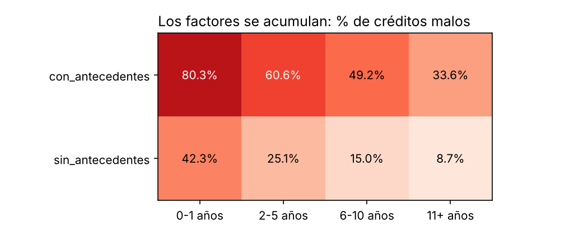
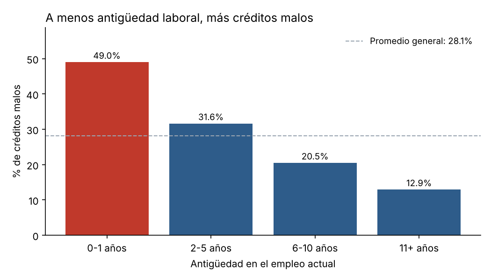
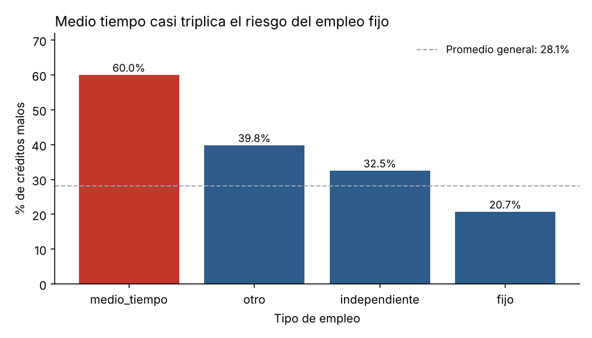

# Riesgo de crédito y calidad de datos: ¿qué solicitudes terminan en mora?

Análisis de 4.452 solicitudes de crédito con **Python, SQL y estadística** para responder dos preguntas de negocio:

1. ¿Qué perfiles de solicitante concentran los créditos que terminan mal?
2. ¿Qué tan confiable es la información con la que se toma esa decisión?

**Resultado principal:** la antigüedad laboral, los antecedentes de impago y el tipo de empleo son los factores más asociados al riesgo, y se acumulan: un solicitante con antecedentes y menos de 2 años en su empleo terminó mal en el **80,3%** de los casos, frente al **8,7%** de quien no tiene antecedentes y lleva más de 10 años. Además, el **8,6%** de las solicitudes no tiene un ingreso válido, y esas solicitudes terminan mal más del doble de veces (57,0% frente a 25,4%).



## 1. Problema de negocio

Una entidad que otorga créditos de consumo quiere reducir la cartera en mora. Para eso necesita saber **en qué segmentos se concentra el riesgo**, y antes de eso, **si sus datos sirven** para medirlo: un ingreso mal registrado puede hacer pasar como seguro a un cliente riesgoso.

## 2. Datos

- **Fuente:** conjunto público *CreditScoring* ([gastonstat/CreditScoring](https://github.com/gastonstat/CreditScoring)), 4.455 solicitudes y 14 columnas.
- **Objetivo:** `Status` (crédito bueno o malo).
- **Variables:** antigüedad laboral, vivienda, plazo, edad, estado civil, antecedentes, tipo de empleo, gastos, ingreso, activos, deuda, monto solicitado y precio del bien.
- Los códigos de las categorías siguen la convención habitual del conjunto y **deben confirmarse con la fuente original** (ver Limitaciones).

## 3. Proceso

| Etapa | Qué hice | Herramienta |
| --- | --- | --- |
| 1. Calidad y limpieza | Detecté valores centinela (99999999), ingresos en 0, códigos sin categoría y duplicados; documenté cada regla y su tratamiento | Python (pandas) |
| 2. Base de consulta | Cargué los datos limpios en una base SQLite | Python + SQLite |
| 3. Consultas | CTEs, `UNION ALL`, `NTILE` y `RANK() OVER` para comparar la tasa de créditos malos por segmento | SQL |
| 4. Estadística | Chi-cuadrado y V de Cramér, Mann-Whitney para ingresos, intervalos de confianza de Wilson y revisión de outliers (IQR) | Python (SciPy) |
| 5. Visualización | Gráficas de riesgo por antigüedad, empleo, parte financiada y factores combinados | Matplotlib |

Reporte de calidad completo: [`reports/reporte_calidad.md`](reports/reporte_calidad.md). Resultados completos: [`reports/resultados.md`](reports/resultados.md). Consultas: [`sql/consultas.sql`](sql/consultas.sql).

## 4. Hallazgos

### Calidad de datos

- Se excluyeron 3 de 4.455 filas (2 duplicadas y 1 sin estado del crédito). Quedan **4.452**.
- **34 ingresos, 47 activos y 18 deudas** venían como `99999999`, un faltante disfrazado de número, y **347 ingresos** venían en 0. Sin limpiarlos, el ingreso promedio habría salido en cientos de miles en lugar de unos cientos.
- Tras la limpieza, **381 solicitudes (8,6%) no tienen ingreso**. No los imputé: rellenar ingresos de clientes reales sesgaría el análisis.
- Esos faltantes **no son aleatorios**: el 57,0% de las solicitudes sin ingreso terminó mal, frente al 25,4% de las que sí lo tienen. Se concentran en independientes (29,7% sin ingreso) frente a empleo fijo (1,2%).

### Riesgo (tasa general de créditos malos: 28,1%)

| Factor | Segmento de mayor riesgo | Segmento de menor riesgo |
| --- | --- | --- |
| Antigüedad laboral | 0–1 años: **49,0%** | 11+ años: **12,9%** |
| Antecedentes | Con antecedentes: **55,5%** (IC 95%: 52,0–59,0) | Sin antecedentes: 22,4% (IC 95%: 21,1–23,8) |
| Tipo de empleo | Medio tiempo: **60,0%** | Fijo: 20,7% |
| Parte del bien financiada | 95% o más: **42,9%** | Menos de 60%: 13,9% |
| Ingreso (solo con dato) | Cuartil más bajo: **40,5%** | Cuartil más alto: 17,0% |

- **Los factores se acumulan.** Financiar el 95% o más del bien con 0–1 años de antigüedad: **64,6%** de créditos malos (n = 144). Financiar menos del 60% con 11+ años: **4,8%** (n = 376).
- Todas las diferencias son estadísticamente significativas (p < 0,001). Las asociaciones más fuertes son antigüedad laboral (V de Cramér 0,30), antecedentes (0,28) y tipo de empleo (0,27).

| | |
| --- | --- |
|  |  |

## 5. Recomendaciones

1. **Revisión manual** de las solicitudes que combinan antecedentes y menos de 2 años de antigüedad: es el grupo con mayor concentración de créditos malos.
2. **Pedir una cuota inicial mayor** cuando el solicitante quiere financiar el 95% o más del bien y tiene poca antigüedad laboral.
3. **Hacer obligatorio y validar el ingreso** en el formulario (sin aceptar 0 ni 99999999), sobre todo para independientes. Un ingreso faltante ya es una señal de riesgo.
4. **Medir mora por franjas de días** (30, 60, 90+) en próximas cargas, para pasar de "bueno/malo" a una gestión de cobro por etapas.

## 6. Limitaciones y supuestos

- **Asociación no es causalidad:** el análisis muestra dónde se concentra el riesgo, no por qué ocurre.
- **Códigos sin diccionario oficial:** el significado de los códigos de vivienda, estado civil y empleo sigue la convención habitual del conjunto y debe confirmarse con la fuente.
- **"Malo" no es lo mismo que días de mora:** la variable objetivo es binaria; no permite medir franjas de mora.
- **Datos históricos y no colombianos:** los porcentajes describen esta muestra y no deben trasladarse tal cual a otra entidad.
- **Uso responsable:** no uso edad ni estado civil como criterio para aprobar o negar créditos; el análisis se enfoca en variables de capacidad y comportamiento de pago.

## 7. Cómo ejecutarlo

```bash
pip install -r requirements.txt
python src/01_calidad_y_limpieza.py   # limpia los datos y genera el reporte de calidad
python src/02_analisis.py             # ejecuta el SQL, la estadística y las gráficas
```

Resultados esperados: `Filas limpias: 4,452 | créditos malos: 1,253 (28.1%)`.

## 8. Estructura

```
riesgo-credito/
├── data/        CreditScoring_raw.csv (original) y credit_clean.csv (limpio)
├── sql/         consultas.sql
├── src/         01_calidad_y_limpieza.py, 02_analisis.py
├── reports/     reporte_calidad.md, resultados.md
└── figures/     gráficas en PNG
```

## 9. Herramientas

Python (pandas, NumPy, SciPy, Matplotlib), SQL (SQLite: CTEs, funciones de ventana), estadística inferencial (chi-cuadrado, V de Cramér, Mann-Whitney, intervalos de Wilson), Git y GitHub.

Usé IA como apoyo para escribir y revisar el código y el SQL. Los resultados se reproducen ejecutando los dos scripts.

## Autor

**Stiven Lizarazo** · Analista de Datos Junior · [LinkedIn](https://www.linkedin.com/in/stiven-lizarazo) · [GitHub](https://github.com/lizarazostiven36-ux)
